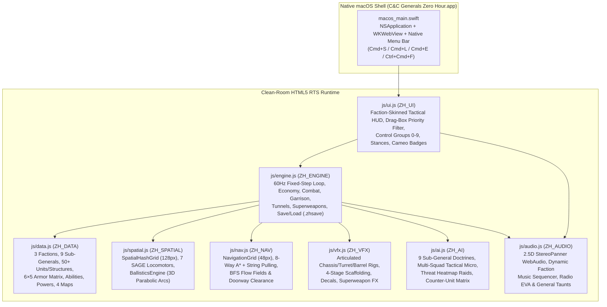

# Product Requirements Document (PRD)
## Command & Conquer: Generals – Zero Hour (macOS Clean-Room Edition v2.0)

| Field | Value |
| :--- | :--- |
| **Product Name** | *Command & Conquer: Generals – Zero Hour (macOS Clean-Room Edition)* |
| **Document Version** | `v2.0` (Phases 1–4 Complete + 4-Tier Human-QA Verified) |
| **Last Updated** | October 21, 2026 |
| **Target Platform** | macOS Native App Bundle (`C&C Generals Zero Hour.app`, Apple Silicon & Intel) + HTML5 Canvas / WebAudio Runtime |
| **Repository** | [`https://github.com/malishan1122/cnc_generals`](https://github.com/malishan1122/cnc_generals) |
| **Engineering Methodology** | Evidence-Gated Clean-Room Reverse Engineering (`SEEN` / `INFERRED` / `UNKNOWN`) of the SAGE (`GeneralsMD`) architecture |

---

## 1. Executive Summary & Product Vision

**Command & Conquer: Generals – Zero Hour (macOS Clean-Room Edition)** is a zero-dependency, native macOS and HTML5 clean-room recreation of EA Pacific's 2003 Real-Time Strategy classic. Built from first principles against the open-sourced SAGE (`GeneralsMD`) architectural specification, it delivers the complete asymmetric 3-faction, 9-Sub-General experience—including **Generals' Challenge** and **Custom Skirmish** modes—inside a native macOS `WKWebView` application (`C&C Generals Zero Hour.app`) and any modern browser without external assets or copyright-encumbered media.

### Core Product Pillars
1. **100% Clean-Room & Self-Contained**: All visuals are rendered via procedural 2.5D isometric HTML5 Canvas geometry (`js/engine.js`, `js/vfx.js`); all sound effects and faction music themes are synthesized in real time via WebAudio (`js/audio.js`); all EVA announcements and General taunts use native macOS SpeechSynthesis.
2. **Authentic Zero Hour Asymmetry**: Full implementation of **USA**, **China**, and **GLA** plus all **9 Zero Hour Sub-Generals** with authentic economy loops, power grid rules, exclusive units, veterancy chevrons, 5-star Generals Powers, and global Superweapons.
3. **Deterministic 60Hz Simulation & Spatial Physics**: Fixed-timestep `1/60s` (`16.67ms`) simulation loop backed by a 128px `SpatialHashGrid`, 7 SAGE locomotor physics profiles, 8-way A* `NavigationGrid` (48px cells) with BFS flow fields, and 3D parabolic projectile ballistics.
4. **4-Tier Automated QA & Human-Interaction Verification**: Every engine subsystem, AI doctrine, balance matchup (`9×9` = 81 games), and synthetic human UI interaction (`123` DOM/Canvas/Keyboard actions across 9 Playbooks) is continuously verified via automated test suites.

---

## 2. System Architecture & Module Map

| File | Responsibility | Lines of Code |
| :--- | :--- | :---: |
| [`index.html`](file:///Users/muhammad.shan/Documents/cnc-generals-zero-hour-mac/index.html) | Application shell, Top Tactical Bar, Isometric Viewport, Bottom Command Bar, Challenge/Skirmish & Powers Modals | ~220 |
| [`css/style.css`](file:///Users/muhammad.shan/Documents/cnc-generals-zero-hour-mac/css/style.css) | Faction-themed HUD styling (`.hud-theme-usa`, `.hud-theme-china`, `.hud-theme-gla`), Cameo grid, modal & badge styles | ~850 |
| [`js/data.js`](file:///Users/muhammad.shan/Documents/cnc-generals-zero-hour-mac/js/data.js) | Declarative INI-style registry (`ZH_DATA`): 3 Factions, 9 Generals, Units, Buildings, Upgrades, Weapons, 4 Maps | ~2,870 |
| [`js/spatial.js`](file:///Users/muhammad.shan/Documents/cnc-generals-zero-hour-mac/js/spatial.js) | `SpatialHashGrid` (`O(1)` 128px queries), `LocomotorPhysics` (7 SAGE locomotor types), `BallisticsEngine` (3D arcs) | ~430 |
| [`js/nav.js`](file:///Users/muhammad.shan/Documents/cnc-generals-zero-hour-mac/js/nav.js) | `NavigationGrid` (48px cells, footprint rasterization, 8-way A* pathfinding, string pulling, BFS flow fields) | ~360 |
| [`js/vfx.js`](file:///Users/muhammad.shan/Documents/cnc-generals-zero-hour-mac/js/vfx.js) | `VFXRenderer` (articulated tank turrets/barrels, 4-stage scaffolding, persistent craters/scorch decals, Nuke/Scud/Particle FX) | ~540 |
| [`js/audio.js`](file:///Users/muhammad.shan/Documents/cnc-generals-zero-hour-mac/js/audio.js) | `ZH_AUDIO` WebAudio spatial synthesizer, procedural faction music sequencer (`USA`/`CHINA`/`GLA`), radio EVA & taunts | ~560 |
| [`js/engine.js`](file:///Users/muhammad.shan/Documents/cnc-generals-zero-hour-mac/js/engine.js) | Core 60Hz deterministic RTS simulation engine, combat, economy, garrison/tunnels, superweapons, `.zhsave` Save/Load | ~4,320 |
| [`js/ai.js`](file:///Users/muhammad.shan/Documents/cnc-generals-zero-hour-mac/js/ai.js) | Autonomous AI Commander with 9 Sub-General personalities, multi-squad roles (`VANGUARD`/`FLANKER`/`BASE_DEFENSE`), counter-matrix | ~920 |
| [`js/ui.js`](file:///Users/muhammad.shan/Documents/cnc-generals-zero-hour-mac/js/ui.js) | Human input controller, drag-box priority filter, Control Groups `0–9`, Tactical Stances, Command Card & Save/Load hotkeys | ~1,510 |
| [`js/simulator.js`](file:///Users/muhammad.shan/Documents/cnc-generals-zero-hour-mac/js/simulator.js) | Deterministic headless `PlanSimulator` for automated multi-doctrine simulation and state invariant auditing | ~520 |
| [`macos_main.swift`](file:///Users/muhammad.shan/Documents/cnc-generals-zero-hour-mac/macos_main.swift) | Native macOS `NSApplication` + `WKWebView` wrapper with native Menu Bar (`Game`, `Audio`, `View`) & Retina support | ~245 |

---

## 3. Faction & 9 Sub-General Requirements (`SYS-01`, `SYS-02`, `SYS-18`)

### 3.1 United States of America (USA)
- **Core Doctrine**: High-tech precision, satellite intelligence, Cold Fusion power grid, Point-Defense Lasers (PDL), Chinook air-supply logistics, Strategy Center battle plans (*Bombardment*, *Hold the Line*, *Search & Destroy*).
- **Sub-Generals**:
  1. **Gen. Malcolm "Ace" Granger (Air Force General)**: Aircraft cost `-20%`, Aircraft HP `+25%`, Aircraft spawn at Veteran rank. Exclusive units: **King Raptor** (`USA_KING_RAPTOR`, PDL + 6 missiles) & **Combat Chinook** (`USA_COMBAT_CHINOOK`, mobile gunship transport).
  2. **Gen. "Pinpoint" Townes (Laser General)**: Cold Fusion Reactors produce `+25%` power, Laser weapons deal `+20%` damage. Exclusive units/defenses: **Laser Crusader** (`USA_LASER_CRUSADER`), **Laser Tank**, and **Laser Turret**.
  3. **Gen. Alexis Alexander (Superweapon General)**: **Particle Cannon** costs `-40%` and recharges `30%` faster, **EMP Patriot** batteries disable enemy vehicles/aircraft on hit. Exclusive unit: **Aurora Alpha Bomber** (`USA_AURORA_ALPHA`, thermobaric fuel-air bomb).

### 3.2 People's Republic of China (China)
- **Core Doctrine**: Heavy armor, Nuclear Reactor power grid, Nationalism ("Horde" `+25%` ROF bonus for 5+ grouped Red Guards / Tank Hunters / Battlemasters / Gattling Tanks), Speaker Tower propaganda healing auras, Gattling/Napalm/Nuclear weaponry, Internet Center Hacker income.
- **Sub-Generals**:
  1. **Gen. Ta Hun Kwai (Tank General)**: Tanks cost `-20%`, spawn at Veteran rank, Battlemaster & Gattling Tanks move `+15%` faster. Exclusive unit: **Emperor Overlord** (`CHINA_EMPEROR_OVERLORD`, intrinsic Speaker Tower + upgradeable Gattling Cannon).
  2. **Gen. "Anvil" Shin Fai (Infantry General)**: Infantry spawn at Veteran rank with `+35%` HP, Horde bonus increased to `+35%`. Exclusive units: **Mini-Gunner** (`CHINA_MINIGUNNER`, twin-chaingun elite infantry) & **Assault Troop Crawler** (`CHINA_ASSAULT_CRAWLER`, mobile armored infantry transport).
  3. **Gen. Tsing Shi Tao (Nuclear General)**: Tanks come pre-equipped with **Uranium Shells** & **Nuclear Tanks** (`+20%` speed, `+20%` damage), Nuclear Reactors produce `+35%` power. Exclusive unit: **Tactical Nuke MiG** (`CHINA_NUKE_MIG`).

### 3.3 Global Liberation Army (GLA)
- **Core Doctrine**: Asymmetric guerrilla warfare, **zero power requirement (`usesPower: false`)**, global subterranean **Tunnel Network** transit + healing (`max 10 units`), **Salvage Crate** vehicle weapon tier progression (`Base -> Tier 1 -> Tier 2`), Anthrax toxin contamination, Black Market late-game economy.
- **Sub-Generals**:
  1. **Dr. Thrax (Toxin General)**: All toxin weapons deal `+35%` damage (Anthrax Gamma intrinsic); Rebels, RPG Troopers, and Tunnel Networks fire toxin-laced rounds.
  2. **Gen. Rodall "Demo" Juhziz (Demolition General)**: High-explosive weapons deal `+35%` damage (`explosiveDamageMult: 1.35`), Terrorists & Scud Launchers cost `-20%`. Exclusive units: **Combat Cycle** (`GLA_COMBAT_CYCLE`, `CLIFF_CLIMBER` motorcycle) & **Bomb Truck**.
  3. **Prince Kassad (Stealth General)**: Tunnel Networks cost `-25%`, all units move `+15%` faster, unlocks **GPS Scrambler** stealth power. Exclusive unit: **Hijacker** (`GLA_HIJACKER`, stealthed infantry with `HIJACK_VEHICLE` ability).

---

## 4. Core Gameplay & Simulation Requirements

### 4.1 Economy, Construction & Power Grid (`SYS-03` – `SYS-05`)
- **Free-Placement Builder Construction**: USA/China **Construction Dozers** and GLA **Workers** physically navigate to build footprints and construct structures from `0%` to `100%`.
- **Doorway Spawn Clearance & Push-Out Physics**: Completed buildings and newly produced units compute a perimeter exit vector (`findClearSpawnSpot` in `js/engine.js`) and apply footprint push-out separation so Dozers, Workers, and trained units never become trapped inside structure footprints.
- **Dual-Tier Economy**:
  - *Primary*: Finite **Supply Docks** harvested by USA Chinooks (`$600/trip`), China Supply Trucks (`$300/trip`), and GLA Workers (`$150/trip`).
  - *Secondary (Infinite Late-Game)*: USA **Supply Drop Zone** (`+$320/10s`), China **Hackers** / **Internet Center** (`+$18–$25/2s`), and GLA **Black Market** (`+$280/8s`).
- **Power Grid & Brownouts**: USA and China structures require `powerProduced >= powerConsumed`. When in `LOW POWER` brownout, base defense turrets go offline, radar minimap disables, and production speed drops to `0.5x`. GLA is immune (`NO POWER NEEDED`).

### 4.2 Physics, Pathfinding & Combat Simulation (`SYS-06` – `SYS-17`)
- **Fixed-Timestep 60Hz Loop & Spatial Hashing (`SYS-14`)**: `GameEngine.update()` advances in deterministic `1/60s` (`16.67ms`) steps. `SpatialHashGrid` (`128px` cells) accelerates target acquisition, boid separation, PDL missile interception, and splash damage to $O(1)$ neighborhood lookups.
- **7 SAGE Locomotor Classes (`SYS-14`)**: `INFANTRY`, `CLIFF_CLIMBER`, `WHEELED`, `TRACKED`, `HOVER`, `HELICOPTER`, and `AIRCRAFT` with turn-rate angular velocity, acceleration/braking, and helicopter/aircraft pitch & roll banking.
- **8-Way A* NavigationGrid & BFS Flow Fields (`SYS-15`)**: `48px` grid rasterizing water, cliffs, and building footprints (`js/nav.js`), supporting line-of-sight string pulling and shared BFS flow fields for group movement.
- **3D Ballistics, EMP & Garrison Clearing (`SYS-16`)**: Parabolic projectile height $z(t) = 4 h_{\text{peak}} t(1-t)$ with ground shadows, scatter radius, EMP disable timers (`empDisabledTimer`), and instant garrison clearing via `FLAME_TOXIN` or `FLASHBANG` weapons.
- **Armor vs. Weapon Scalar Matrix**: 6 weapon damage types (`SMALL_ARMS`, `SNIPER`, `ARMOR_PIERCING`, `HIGH_EXPLOSIVE`, `FLAME_TOXIN`, `SUPERWEAPON`) across 5 armor classes (`INFANTRY`, `LIGHT_VEHICLE`, `TANK`, `AIRCRAFT`, `BUILDING`).
- **Neutral Tech Structures & Civilian Bunkers (`SYS-17`)**:
  - **Tech Oil Derrick**: Capturable by infantry; grants `+$1,000` capture bonus + `+$35/2s` continuous income.
  - **Tech Hospital**: Grants `+6 HP/s` global infantry regeneration.
  - **Tech Repair Bay**: Grants `+8 HP/s` global vehicle repair.
  - **Civilian Garrison Bunkers**: Hold up to `6` infantry firing from window ports with `+40%` armor protection and `+25%` weapon range; evacuable via Command Card `EVACUATE [E]` or cleared by Flame/Toxin/Flashbang weapons.
- **Active Unit Micro-Abilities (`[F]`, `SYS-18`)**:
  - `FLASHBANG` (US Ranger): Clears enemy garrisoned bunkers and deals stun/area infantry damage.
  - `LASER_LOCK` (US Missile Defender): Paints enemy armor (`🎯 LASER LOCKED`) for `+50%` rate-of-fire and `+25%` damage.
  - `FLAME_WALL` (China Dragon Tank): Ignites a persistent `6s` napalm firestorm ring (`110px` radius).
  - `OVERLORD_SPEAKER` / `GATLING_CANNON` (China Overlord): Installs permanent field Speaker Tower (`[F]`) or Gatling Cannon (`[R]`) turret addon on the Overlord chassis.
  - `PILOT_SNIPE` (GLA Jarmen Kell): Snipes enemy vehicle crew (`team = -1, unmanned = true`), allowing any infantry unit to right-click and re-crew the vehicle.
  - `HIJACK_VEHICLE` (GLA Hijacker): Captures an enemy vehicle directly into the player's control.

---

## 5. User Interface, Controls & Audio/Visual Requirements (`SYS-19` – `SYS-24`)

### 5.1 Tactical Command Bar & Input Ergonomics
- **Faction-Skinned HUD (`SYS-20`)**: Dynamic CSS theme switching between `.hud-theme-usa` (tactical cobalt/cyan), `.hud-theme-china` (crimson/gold), and `.hud-theme-gla` (amber/olive).
- **RTS Drag-Box Selection Priority Filter (`BUG-HUMAN-03`)**: Drag-selecting across a base that contains both combat troops and unarmed `isBuilder` (Dozer/Worker) or `isHarvester` (Chinook/Supply Truck) units automatically filters out the non-combat economy units so the player receives combat controls and stances instead of the Dozer build menu.
- **Control Groups `0–9` (`SYS-19`, `BUG-HUMAN-07`)**:
  - `Ctrl + [0–9]` (or `Cmd + [0–9]`) binds selected combat squads **or production buildings** (Command Center, Barracks, War Factory, Airfield).
  - Single-tapping `[0–9]` recalls the control group; double-tapping `[0–9]` within `340ms` centers the camera on the group's centroid.
  - Control group bindings (for both units and buildings) persist across Quick Save `[F5]` and Quick Load `[F9]`.
- **Tactical Stances & Command Modifiers (`SYS-19`)**:
  - `[A]` + Left-Click: **Attack-Move** (`ATTACK_MOVE`).
  - `[G]`: **Guard** (`GUARD` stance with `220px` pursuit leash returning to anchor `(guardX, guardY)`).
  - `[S]`: **Stop** (`IDLE`).
  - `[X]`: **Scatter** (radial dispersal to dodge artillery/superweapons).
  - `Ctrl + Right-Click`: **Force-Fire** (`FORCE_FIRE`) on ground coordinates or neutral structures.
  - `Shift + Right-Click`: **Chained Waypoints** rendered as connected emerald path nodes on the battlefield.
- **Cameo Queue Badges, Right-Click Refund & Radar Alerts (`SYS-20`)**:
  - Production cameos render live queue count badges (`xN`) and radial progress sweeps.
  - Right-clicking a queued unit cameo cancels the last unit of that type and refunds `100%` of its credit cost.
  - Combat impacts trigger animated red radar rings on the minimap; pressing `Spacebar` snaps the camera to the latest alert coordinate (`jumpToLastAlert`).

### 5.2 2.5D Isometric Visuals & Spatial Audio (`SYS-21` – `SYS-23`)
- **Articulated Multi-Part 2.5D Unit Rigs (`SYS-21`)**: Decoupled hull orientation (`u.angle`), independent turret rotation (`u.turretAngle`), and weapon barrel recoil translation (`u.recoilOffset`, including alternating dual-barrel recoil on Overlord, Emperor, Marauder, Quad Cannon, and Gattling Tank).
- **4-Stage Construction Scaffolding & Damage Plumes (`SYS-21`)**: Progressive scaffolding (`0–33%` foundation stakes, `33–66%` steel girders, `66–99%` crane sweeps, `100%` operational structure) plus dark smoke below `50%` HP and flickering fire tongues below `25%` HP.
- **Persistent Decals & Superweapon Spectacle (`SYS-22`)**: Persistent blast craters, Particle Cannon scorch ribbons, tank tread tracks, expanding shockwave rings, rising multi-layered Nuclear mushroom clouds, Scud Storm anthrax cloud banks, and thermal whiteout flashes (`js/vfx.js`).
- **2.5D Spatial WebAudio & Dynamic Faction Music (`SYS-23`)**: Camera-relative `StereoPannerNode` panning (`[-1.0, +1.0]`), distance attenuation, procedural faction music themes (`USA`, `CHINA`, `GLA`) that intensify during active combat (`[M]` mute toggle), and radio-filtered EVA voice synthesis (`js/audio.js`).

---

## 6. Persistence, Tactical AI, Balance & macOS Native Shell (`SYS-25` – `SYS-30`)

### 6.1 Deterministic Skirmish Save/Load & `.zhsave` Persistence (`SYS-25`)
- **Quick Save `[F5]` & Quick Load `[F9]`**: Serializes and restores the complete match state (map, match time, teams, credits, power, Generals Rank/Points/Cooldowns, units, buildings, production queues, control groups for both units and buildings, tech buildings, garrison bunkers, salvage crates, hazards, decals, fog of war, and AI state).
- **Menu & Modal Accessibility (`BUG-HUMAN-06`)**: Pressing `[F9]` works both during active gameplay and directly from the Start Screen (`#start-modal`), Main Menu (`☰ MENU`), or Victory/Defeat modal (`#victory-modal`), automatically restoring the match and closing any open menu modal.
- **Dual Storage Backend**: Persists to browser `localStorage` with an automatic in-memory slot fallback (`GameEngine._memorySaveSlots`) for restricted/headless environments, plus `.zhsave` file export (`Cmd+E`) and import.

### 6.2 Multi-Squad Tactical AI & 9×9 Balance Matrix (`SYS-26`, `SYS-27`)
- **Multi-Squad Tactical Roles (`js/ai.js`)**:
  - `BASE_DEFENSE`: Guards base perimeter and intercept vectors.
  - `FLANKER`: Hunts enemy Dozers, Workers, and Supply Harvesters using threat-avoidance pathing (`findHighValueRaidTarget`) that skirts enemy defense turrets.
  - `VANGUARD`: Main combined-arms assault wave supported by dynamic counter-unit production (`computeCounterWeights`) and spatial cluster targeting (`findBestClusterTarget`) for Superweapons and Generals Powers.
- **9×9 Sub-General Balance Telemetry (`tests/balance_matrix.js`)**:
  - Verified across all **81 head-to-head matchups** (`9 Sub-Generals × 9 Sub-Generals`) with `0` runtime errors:
    - **USA Aggregate Win Rate**: `47.9%` (within the `35%–65%` target band)
    - **China Aggregate Win Rate**: `53.0%` (within the `35%–65%` target band)
    - **GLA Aggregate Win Rate**: `49.1%` (within the `35%–65%` target band)

### 6.3 Native macOS `.app` v2.0 Shell (`SYS-28`)
- Compiled native macOS binary (`C&C Generals Zero Hour.app/Contents/MacOS/CnCGeneralsZeroHour`) built from [`macos_main.swift`](file:///Users/muhammad.shan/Documents/cnc-generals-zero-hour-mac/macos_main.swift).
- **Native macOS Menu Bar**:
  - **Game Menu**: *New Operation / Main Menu* (`Cmd+N`), *Pause / Resume* (`Cmd+P`), *Quick Save* (`Cmd+S`), *Quick Load* (`Cmd+L`), *Export .zhsave Snapshot...* (`Cmd+E`).
  - **Audio Menu**: *Toggle SFX*, *Toggle Dynamic Music* (`Cmd+M`), *Toggle EVA Voice*.
  - **View Menu**: *Reset Camera to Base* (`Cmd+H`), *Jump to Radar Alert* (`Space`), *Toggle Fullscreen* (`Ctrl+Cmd+F`).

---

## 7. 4-Tier Automated QA & Verification Gates (`SYS-24`, `SYS-29`, `SYS-30`)

Every release candidate must pass all 5 automated verification runners with **0 failures**:

| Suite | Command | Scope & Assertions | Status |
| :--- | :--- | :--- | :---: |
| **1. Phase 2 Engine Suite** | `node tests/phase2_verify.js` | SpatialHashGrid, 7 Locomotors, 8-Way A* NavGrid, 3D Ballistics, Garrisoning, Tech Buildings, Exclusive Units, 9 AI Doctrines | **6 / 6 PASS** |
| **2. Phase 3 UX/VFX/Audio Suite** | `node tests/phase3_verify.js` | Control Groups `0–9`, Guard Leash, Force-Fire, Scatter, Waypoints, Cameo Refunds, Articulated Rigs, Decals, Superweapons, Spatial Audio, Doorway Clearance | **26 / 26 PASS** |
| **3. Plan Simulator & Bug Audit** | `node tests/simulator_verify.js` | All 6 engine/AI/data bug regressions (`BUG-01..06`), 9 full AI-vs-AI skirmish simulations, UI fuzzing | **17 / 17 PASS** |
| **4. Phase 4 & 9×9 Balance Suite** | `node tests/phase4_verify.js` | `.zhsave` Save/Load round-trip, Multi-Squad Tactical AI Micro, 81-matchup `9×9` General Balance Matrix, macOS `.app` v2.0 verification | **29 / 29 PASS** |
| **5. Human-User UI Playbook Runner** | `node tests/human_qa_runner.js` | **9 End-to-End Human Playbooks** dispatching **123 synthetic DOM `.click()`, `<canvas>` mouse, and `window` keyboard events** (`BUG-HUMAN-01..07`) | **61 / 61 PASS** |
