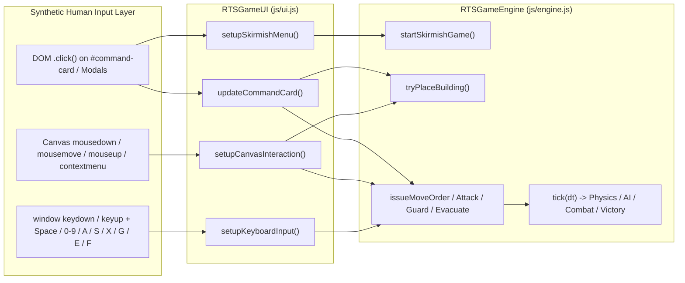

# RTS Human-User QA Playbook
### *Command & Conquer: Generals – Zero Hour (macOS Clean-Room Edition)*

---

## 1. Executive Summary & Philosophy

When testing an HTML5/Canvas Real-Time Strategy (RTS) game, **headless engine tests alone are blind to UI-to-Engine integration bugs**. An engine method like `engine.useUnitAbility()` or `engine.evacuateGarrison()` may work when called with hand-crafted parameters in a unit test, yet completely fail when a real human clicks a button on `#command-card` or presses `[F]` / `[E]` on the keyboard.

This playbook distills industry-standard automated game QA methodologies (Riot Games, EA SEED, Ubisoft La Forge, and Agent-in-the-Loop browser testing) into an actionable, repeatable **Human-User QA Playbook** and an automated **Human-User QA Runner** ([`tests/human_qa_runner.js`](file:///Users/muhammad.shan/Documents/cnc-generals-zero-hour-mac/tests/human_qa_runner.js)).

---

## 2. Industry QA Methodologies Applied

### 2.1 The 4-Tier Game Testing Pyramid
| Tier | Testing Layer | How It Works in This Repo | Bugs Caught |
| :--- | :--- | :--- | :--- |
| **Tier 1** | **Static Schema & Data Cross-Reference** | Scans [`ZH_DATA`](file:///Users/muhammad.shan/Documents/cnc-generals-zero-hour-mac/js/data.js#L6) against [`RTSGameEngine`](file:///Users/muhammad.shan/Documents/cnc-generals-zero-hour-mac/js/engine.js#L13) and [`RTSGameUI`](file:///Users/muhammad.shan/Documents/cnc-generals-zero-hour-mac/js/ui.js#L9) for type/property contract mismatches (`ability` object vs string, `overlordAddon` vs `hasSpeakerTower`, `HIGH_EXPLOSIVE` vs `EXPLOSIVE`). | `BUG-HUMAN-01`, `BUG-HUMAN-04`, `BUG-HUMAN-05` |
| **Tier 2** | **Deterministic Headless Simulation** | [`tests/simulator_verify.js`](file:///Users/muhammad.shan/Documents/cnc-generals-zero-hour-mac/tests/simulator_verify.js) runs 22 subsystem suites + 3×3 Faction Matrix + 4,500-tick AI-vs-AI stress matches with seeded Mulberry32 PRNG (`0xDEADBEEF`). | `BUG-01` through `BUG-06` (Engine/AI/Data bugs) |
| **Tier 3** | **Synthetic Human-UI Playbook Execution** | [`tests/human_qa_runner.js`](file:///Users/muhammad.shan/Documents/cnc-generals-zero-hour-mac/tests/human_qa_runner.js) loads [`index.html`](file:///Users/muhammad.shan/Documents/cnc-generals-zero-hour-mac/index.html) and drives the game **strictly via DOM `.click()`, `<canvas>` mouse events, and `window` keyboard events** across 9 Playbooks (`61/61 PASS`). | `BUG-HUMAN-01` through `BUG-HUMAN-07` |
| **Tier 4** | **Live Visual & Exploratory Session Testing** | Human/Browser agent launches `python3 -m http.server 8080`, plays through 4 Exploratory Personas, and inspects visual rendering, audio synthesis, and HUD polish. | Visual clipping, audio glitches, UX friction |

---

### 2.2 The Golden Rule of Human-User RTS QA

> **NEVER call `engine.startPlacement()`, `engine.produceUnit()`, `engine.issueMoveOrder()`, `engine.evacuateGarrison()`, or `engine.useUnitAbility()` directly during a Human QA Playbook.**
> Every action must enter through the exact DOM event listeners registered by [`RTSGameUI`](file:///Users/muhammad.shan/Documents/cnc-generals-zero-hour-mac/js/ui.js#L9).



---

## 3. Coordinate Math & Input Translation Reference

When interacting with `#game-canvas` as a human player, world coordinates $(wx, wy)$ must be converted into browser client coordinates $(clientX, clientY)$ using the camera's current viewport offset (`engine.cameras[0]`):

$$\text{clientX} = \text{rect.left} + \frac{wx - \text{cam.x}}{\text{cam.zoom}}, \qquad \text{clientY} = \text{rect.top} + \frac{wy - \text{cam.y}}{\text{cam.zoom}}$$

In [`tests/human_qa_runner.js`](file:///Users/muhammad.shan/Documents/cnc-generals-zero-hour-mac/tests/human_qa_runner.js#L251-L343), the [`HumanBot`](file:///Users/muhammad.shan/Documents/cnc-generals-zero-hour-mac/tests/human_qa_runner.js#L251) helper class encapsulates all 7 human interaction primitives:

1. **`human.centerCameraOn(wx, wy)`**: Pans `engine.cameras[0]` so target world coordinates are centered inside the `1280×800` viewport before clicking.
2. **`human.leftClickWorld(wx, wy, opts)`**: Dispatches `mousemove` $\to$ `mousedown (button: 0)` $\to$ `mouseup (button: 0)` on `#game-canvas` (displacement $< 5\text{px}$, triggering [`handleSingleClick`](file:///Users/muhammad.shan/Documents/cnc-generals-zero-hour-mac/js/ui.js#L859)).
3. **`human.dragBoxWorld(wx1, wy1, wx2, wy2, opts)`**: Dispatches `mousedown (button: 0)` at $(wx_1, wy_1)$ $\to$ `mousemove` to $(wx_2, wy_2)$ $\to$ `mouseup (button: 0)` (displacement $\ge 5\text{px}$, triggering [`handleBoxSelection`](file:///Users/muhammad.shan/Documents/cnc-generals-zero-hour-mac/js/ui.js#L934)).
4. **`human.rightClickWorld(wx, wy)`**: Dispatches `mousemove` $\to$ `mousedown (button: 2)` $\to$ `mouseup (button: 2)` $\to$ `contextmenu` on `#game-canvas` (triggering [`handleRightClick`](file:///Users/muhammad.shan/Documents/cnc-generals-zero-hour-mac/js/ui.js#L952)).
5. **`human.clickCommandButton(textSubstring)`**: Searches visible `.cmd-btn` elements inside `#command-card` by label/hotkey text and calls `.click()` (after calling [`ui.updateCommandCard()`](file:///Users/muhammad.shan/Documents/cnc-generals-zero-hour-mac/js/ui.js#L351)).
6. **`human.pressKey(key, opts)`**: Dispatches `keydown` and `keyup` with `{ key, ctrlKey, shiftKey }` on `window` (triggering [`setupKeyboardInput`](file:///Users/muhammad.shan/Documents/cnc-generals-zero-hour-mac/js/ui.js#L1063)).
7. **`human.clickMinimap(wx, wy)`**: Maps world coordinates to `#minimap-canvas` ($196\times 196$) and dispatches `mousedown` $\to$ `mouseup` (triggering [`setupMinimapInteraction`](file:///Users/muhammad.shan/Documents/cnc-generals-zero-hour-mac/js/ui.js#L1026)).

---

## 4. The 8 Automated Human-User QA Playbooks

Run the full automated suite at any time with:

```bash
node tests/human_qa_runner.js
```

### Playbook 1: Skirmish Lobby DOM Flow & Match Launch
- **Human Actions**:
  1. Verify `#skirmish-menu` is visible (`!classList.contains('hidden')`) on initial page load.
  2. Click `.general-card[data-general="USA_GRANGER"]` and assert `.selected` moves to Granger and `#general-detail-panel` updates.
  3. Click `.general-card[data-general="USA"]` to select standard USA.
  4. Click `.diff-btn[data-diff="MEDIUM"]`, `.map-btn[data-map="DESERT_STORM"]`, `.cash-btn[data-cash="50000"]`, and `#ai-general-select` (`CHINA`).
  5. Click `#start-game-btn` ("LAUNCH BATTLE").
- **Oracle Checks**:
  - `#skirmish-menu` gains class `.hidden`.
  - `engine.running === true`, `engine.players[0].credits === 50000`, `engine.players[0].faction === 'USA'`, `engine.players[1].faction === 'CHINA'`.
  - Starting `USA_COMMAND_CENTER` and `USA_DOZER` exist on the map.

### Playbook 2: Base Construction via Command Card & Canvas Clicks
- **Human Actions**:
  1. Left-click the player's `USA_DOZER` on `#game-canvas` (or press `[B]`).
  2. Verify `#selection-name` reads `USA Construction Dozer` and `#command-card` renders `.cmd-btn` elements (`Cold Fusion Reactor`, `Barracks`, `Supply Center`, etc.).
  3. Click `.cmd-btn` matching `Cold Fusion Reactor` $\to$ assert `ui.placementMode.type === 'USA_POWER_PLANT'` $\to$ left-click valid terrain on `#game-canvas`.
  4. Re-select the Dozer, click `Supply Center`, left-click valid terrain; repeat for `Barracks`, `War Factory`, and `Strategy Center`.
  5. Advance simulation ticks while the Dozer drives to each scaffold and constructs it to `100%`.
- **Oracle Checks**:
  - Each left-click on valid terrain deducts credits, spawns a `underConstruction: true` building, and clears `ui.placementMode`.
  - Once built, `USA_POWER_PLANT` increases `powerProduced`, and `USA_SUPPLY_CENTER` auto-spawns a free `USA_CHINOOK` harvester.

### Playbook 3: Unit Production, Rally Points & Control Groups (`Ctrl+1` / `1`)
- **Human Actions**:
  1. Left-click the completed `USA_BARRACKS` on `#game-canvas`.
  2. Right-click open ground at `(base.x + 220, base.y + 80)` to set `rallyPoint`.
  3. Click `.cmd-btn` `Ranger [Q]` 3 times and `Missile Defender [W]` 2 times on `#command-card`.
  4. Left-click `USA_WAR_FACTORY`, right-click to set its rally point, and click `Crusader Tank [Q]` + `Humvee [W]`.
  5. Advance ticks until all queued units spawn and walk to the rally point.
  6. Drag-box select the spawned combat squad on `#game-canvas`.
  7. Press `Ctrl+1` to bind Control Group 1 $\to$ click empty ground to deselect $\to$ press `1` to recall Control Group 1.
- **Oracle Checks**:
  - `barracks.rallyPoint` matches the right-clicked world coordinate.
  - All 5 infantry and 2 vehicles spawn and move to the rally point.
  - Pressing `1` restores `engine.selectedIds` to the bound squad.

### Playbook 4: Tactical Combat Orders (`[A]`, `[G]`, `[X]`, `[S]`), Minimap & Camera (`[Space]`, `[H]`)
- **Human Actions**:
  1. With Control Group 1 selected, press `[A]` (or click `ATTACK MOVE [A]` on `#command-card`) $\to$ assert `ui.commandCursorMode === 'ATTACK_MOVE'` $\to$ left-click `#game-canvas` toward enemy territory.
  2. Press `[G]` (or click `GUARD [G]`) $\to$ assert units enter `state === 'GUARD'`.
  3. Press `[X]` (Scatter) $\to$ assert units receive spread destinations.
  4. Press `[S]` (Stop) $\to$ assert units return to `state === 'IDLE'`.
  5. Left-click `#minimap-canvas` at the enemy base coordinates $\to$ assert `engine.cameras[0]` pans there.
  6. Press `[H]` $\to$ assert camera snaps back to the player's Command Center.
  7. Trigger an alert event and press `[Space]` $\to$ assert camera jumps to `engine.lastEventPos[0]`.

### Playbook 5: Mixed Base Drag-Box Selection (Dozer + Combat Squad UX Check)
- **Human Actions**:
  1. Position a `USA_DOZER` and a `USA_RANGER` side-by-side (`15px` apart).
  2. Drag a selection box across both units on `#game-canvas`.
  3. Inspect `engine.selectedIds`, `#command-card`, and press `[G]` (Guard).
- **Oracle Checks**:
  - Standard RTS ergonomics (and C&C Generals rules) require drag-box selection containing combat units to exclude unarmed `isBuilder` / `isHarvester` units so the player gets combat controls instead of the Dozer build menu. *(Caught **`BUG-HUMAN-03`**!)*

### Playbook 6: Civilian Bunker Garrison, Evacuate (`[E]`) & Sell Building (`[Z]`)
- **Human Actions**:
  1. Left-click a `USA_RANGER` on `#game-canvas`, then right-click an neutral `CIV_BUNKER` to garrison it.
  2. Advance ticks until the Ranger enters `bunker.garrisonedUnits`.
  3. Left-click the `CIV_BUNKER` on `#game-canvas` and click `EVACUATE [E]` on `#command-card` (or press `[E]`).
  4. Left-click a player-owned `USA_BARRACKS` and click `SELL [Z]` on `#command-card` (or press `[Z]`).
- **Oracle Checks**:
  - Clicking `EVACUATE [E]` empties `bunker.garrisonedUnits` and restores the Ranger at the bunker's perimeter. *(Caught **`BUG-HUMAN-02`**!)*
  - Clicking `SELL [Z]` refunds 50% of the Barracks' cost (`+$300`) and removes the building.

### Playbook 7: Active Unit Abilities (`[F]`), Upgrades, General's Powers & Superweapons
- **Human Actions**:
  1. Research `Flashbang Grenades` at the Barracks, then left-click a `USA_RANGER` on `#game-canvas`.
  2. Check `#command-card` for the `Flashbang Grenades [F]` ability button and press `[F]` + left-click a target enemy cluster. *(Caught **`BUG-HUMAN-01`**!)*
  3. Click `#gen-powers-btn` (`★ POWERS [F1]`) on the top HUD $\to$ assert `#generals-modal` opens $\to$ click `.gp-card` for `Paladin Tank` (`USA_GP_PALADIN`) $\to$ close modal $\to$ click `Paladin Tank` in `#powers-bar` $\to$ left-click `#game-canvas` to deploy.
  4. Construct `USA_PARTICLE_CANNON`, fast-forward `engine.superweaponTimers[0].USA_PARTICLE_CANNON = 0`, click `#sw-USA_PARTICLE_CANNON_0` in `#superweapon-timers` $\to$ left-click enemy base on `#game-canvas`.
- **Oracle Checks**:
  - `USA_RANGER` displays and fires `Flashbang Grenades [F]`.
  - Purchasing and targeting a General's Power or Superweapon via DOM clicks spawns the effect at the clicked world coordinates.

### Playbook 8: Cross-Faction Special Mechanics & Victory Screen Modal
- **Human Actions**:
  1. Spawn a `CHINA_OVERLORD`, left-click it on `#game-canvas`, and click `Speaker Tower [Q]` on `#command-card`. Inspect `#selection-stats` for `Addon: SPEAKER_TOWER` and check if the `Speaker Tower [Q]` button updates to `INSTALLED`. *(Caught **`BUG-HUMAN-04`**!)*
  2. Lock a `USA_MISSILE_DEFENDER` onto an enemy tank (`laserLockTimer = 5.0`), left-click the enemy tank, and inspect `#selection-stats` for `🎯 LASER LOCKED`. *(Caught **`BUG-HUMAN-04`**!)*
  3. Launch a skirmish with GLA Demolition General Juhziz (`GLA_JUHZIZ`, `explosiveDamageMult: 1.35`) and fire a `GLA_SCUD_LAUNCHER` at an enemy target. Compare damage dealt against standard GLA. *(Caught **`BUG-HUMAN-05`**!)*
  4. Eliminate all enemy structures/units, run `engine.tick(0.05)` until victory triggers, and verify `#victory-modal` becomes visible (`!classList.contains('hidden')`) with `#victory-title` = `VICTORY!`.

### Playbook 9: Phase 4 Save/Load (`[F5]` / `[F9]`) from Menu & Building Control Groups (`[Ctrl+2]`)
- **Human Actions**:
  1. Left-click the player's Command Center on `#game-canvas` and press `Ctrl+2` to bind it to Control Group 2.
  2. Press `[F5]` to Quick Save the skirmish snapshot.
  3. Click `☰ MENU` (`#btn-main-menu`) to pause the engine (`engine.running === false`) and open `#start-modal`.
  4. Press `[F9]` while on the Main Menu / Start Screen to Quick Load the saved snapshot. *(Caught **`BUG-HUMAN-06`**!)*
  5. Click empty ground to deselect, then press `[2]` to recall the Command Center via Control Group 2. *(Caught **`BUG-HUMAN-07`**!)*
- **Oracle Checks**:
  - Pressing `[F9]` from the Main Menu / Start Screen restores `engine.running === true` and hides `#start-modal`.
  - Building Control Group 2 (`engine.controlGroups['2']`) survives `serializeState` / `deserializeState` and re-selects the Command Center when `[2]` is pressed.

---

## 5. Exploratory Human-Persona Playtesting Guide (Live Browser)

When performing live browser QA (`python3 -m http.server 8080`), adopt these four **Session-Based Exploratory Testing (SBET)** personas for 5 minutes each:

1. **The "Boomer / Macro Architect" Persona**:
   - Queue 5 buildings simultaneously with 2 Dozers, cancel a half-built structure (`[Delete]` or `CANCEL`), sell a Power Plant (`[Z]`) to intentionally trigger `LOW POWER`, and verify radar/superweapon timers pause and `#stat-power` turns red.
2. **The "APM Spammer / Micro Tactician" Persona**:
   - Rapidly box-select mixed armies near your base, bind `Ctrl+1`..`Ctrl+3`, spam `[A]`, `[X]`, `[G]`, `[S]`, garrison and immediately evacuate (`[E]`) civilian buildings, and trigger unit abilities (`[F]`) mid-combat.
3. **The "General's Power & Superweapon Specialist" Persona**:
   - Play as sub-generals (`USA_GRANGER`, `USA_ALEXANDER`, `CHINA_FAI`, `CHINA_TAO`, `GLA_JUHZIZ`, `GLA_THRAX`), verify faction-specific unit cost/damage/veterancy modifiers actually apply in combat, and fire every General's Power from `#powers-bar`.
4. **The "Chaos Monkey / Edge-Case Probe" Persona**:
   - Try placing buildings on cliffs, water, bridges, or directly on top of units; right-click friendly units vs enemy units; press `Escape` while in `placementMode`, `superweaponTargeting`, `powerTargeting`, and `abilityTargetingMode`.

---

## 6. Quick Commands Reference

```bash
# 1. Run the Human-User UI Playbook Runner (9 playbooks, 123 human UI actions, 61/61 assertions PASS)
node tests/human_qa_runner.js

# 2. Run the Headless Engine/AI Simulator Suite (17/17 PASS)
node tests/simulator_verify.js

# 3. Run the Phase 4 Save/Load, Tactical AI & 9x9 Balance Suite (29/29 PASS)
node tests/phase4_verify.js
```
