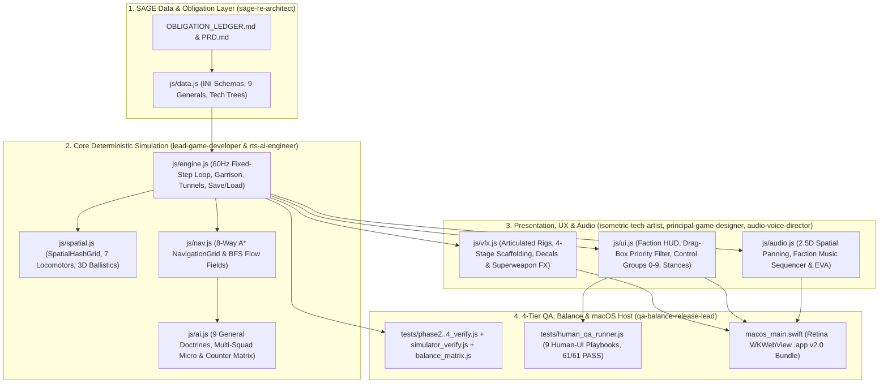

# Command & Conquer: Generals – Zero Hour (macOS Clean-Room Edition)
## Studio Organization & Production Master Plan

> [!IMPORTANT]
> **Standalone Project & GitHub Repository:** The project—including the compiled native macOS application (`C&C Generals Zero Hour.app`), source modules, [`PRD.md`](PRD.md), [`OBLIGATION_LEDGER.md`](OBLIGATION_LEDGER.md), [`QA_PLAYBOOK.md`](QA_PLAYBOOK.md), [`BUG_REPORT.md`](BUG_REPORT.md), and the `.agents/skills/leanrea` reverse-engineering skill—is located at `/Users/muhammad.shan/Documents/cnc-generals-zero-hour-mac` and version-controlled at [`https://github.com/malishan1122/cnc_generals`](https://github.com/malishan1122/cnc_generals).

---

## 1. The 7-Person Game Studio Team Roster

All 7 specialist subagents have been defined, onboarded, and convened across Phases 1–4:

| # | Subagent Handle | Studio Role | Core Domain & Ownership |
|---|---|---|---|
| **1** | `lead-game-developer` | **Lead RTS Engine & Gameplay Developer** | Fixed-timestep 60Hz deterministic loop, `SpatialHashGrid`, `LocomotorPhysics`, `BallisticsEngine` (`js/spatial.js`), urban garrisons, and GLA Tunnel Networks (`js/engine.js`). |
| **2** | `principal-game-designer` | **Principal Game & UI/UX Designer** | Authentic *Zero Hour* Tactical Command Bar (`js/ui.js`), drag-box priority filter, Control Groups (`0–9`), Attack-Move/Guard/Force-Fire stances, Cameo queues, Rally Lines, and Radar Pings. |
| **3** | `sage-re-architect` | **SAGE Reverse-Engineering & INI Systems Architect** | `OBLIGATION_LEDGER.md` governance, declarative `INI` schema (`js/data.js`), Sub-General exclusive units, active `[F]` unit abilities, neutral Tech Structures, and 5-Rank Science trees. |
| **4** | `isometric-tech-artist` | **Isometric 2.5D/3D Technical Artist & VFX Specialist** | Articulated multi-part chassis/turret/barrel rigs (`js/vfx.js`), persistent decal layer (tread marks, craters, scorch marks), 4-stage building scaffolding/damage, and Superweapon VFX spectacles. |
| **5** | `audio-voice-director` | **Audio Director, Sound Designer & Voice/EVA Engineer** | Spatial 2.5D WebAudio compressor/panner bus (`js/audio.js`), procedural weapon SFX, interactive faction music sequencer (USA/China/GLA), and radio-filtered EVA/General voice lines. |
| **6** | `rts-ai-engineer` | **RTS Tactical AI & Pathfinding Engineer** | 8-Way A* + BFS Flow Field navigation (`js/nav.js`), 9 General signature AI doctrines (`js/ai.js`), multi-squad flanking/Dozer-hunting micro, and intelligent Superweapon/Power cluster targeting. |
| **7** | `qa-balance-release-lead` | **QA, Combat Balance & macOS Native Release Lead** | 4-Tier Automated QA suites (`tests/phase2_verify.js`, `tests/phase3_verify.js`, `tests/phase4_verify.js`, `tests/simulator_verify.js`, `tests/balance_matrix.js`, `tests/human_qa_runner.js`), `.zhsave` Save/Load, and native macOS Retina/Menu Bar polish (`macos_main.swift`). |

---

## 2. Studio Subsystem Architecture

---

## 3. Specialist Audits & Phase 2–4 Deliverables

### 3.1 Lead RTS Engine & Gameplay Developer (`lead-game-developer`)
1. **`FixedStepSimulation` & `SpatialHashGrid` (`js/spatial.js`):** 60Hz deterministic accumulator (`FIXED_STEP = 1/60`) and uniform 128px spatial grid dropping collision, aura, and target-scan queries from $O(N^2)$ to $O(k)$.
2. **`LocomotorPhysics` & Boid Separation (`js/spatial.js`):** 7 distinct chassis profiles (`INFANTRY`, `CLIFF_CLIMBER`, `WHEELED`, `TRACKED`, `HOVER`, `HELICOPTER`, `AIRCRAFT`) with angular turn rates, acceleration curves, and boid repulsion forces.
3. **`BallisticsEngine` & 3D Arc Projectiles (`js/spatial.js`):** Parabolic trajectories $z(t) = 4h \cdot t(1-t)$ for artillery/Nuke Cannon/Scud Launcher, ground shadows, EMP disable timers, and missile interception by Paladin Point-Defense Lasers.
4. **Urban Garrisoning, Doorway Clearance & Tunnel Transit (`js/engine.js`):** Neutral civilian building garrison slots (up to 6 infantry) with firing port damage/range bonuses, instant clearing when hit by `FLAME_TOXIN` or `FLASHBANG` weapons, `[E]` Evacuation, and perimeter doorway spawn clearance (`findClearSpawnSpot`).

### 3.2 Principal Game & UI/UX Designer (`principal-game-designer`)
1. **Pro RTS Selection, Priority Filtering & Control Groups (`0–9`):** Full `Ctrl+[0-9]` group binding for both combat squads and production buildings (`BUG-HUMAN-07`), single-tap recall, double-tap camera snap, double-click same-type viewport selection, and drag-box combat priority filtering (`BUG-HUMAN-03`).
2. **Tactical Command Stances & Context Cursors:** Keyboard & HUD buttons for `A` (Attack-Move), `G` (Guard 220px area leash), `S` (Stop), `X` (Scatter), `Ctrl+RightClick` (Force-Fire), and `Shift+RightClick` (Waypoint path queuing).
3. **Cameo Production Queues & Rally Point Lines:** Multi-unit queue count badges (`xN`), radial build-progress sweeps on Cameo buttons, right-click 100% credit refund (`cancelProduction`), and animated dashed rally-point lines.
4. **Under-Attack Radar Pings & Faction-Skinned HUD:** Pulsing red minimap rings, `Spacebar` jump-to-alert, and dynamic faction HUD themes (`.hud-theme-usa`, `.hud-theme-china`, `.hud-theme-gla`).

### 3.3 SAGE Reverse-Engineering & INI Systems Architect (`sage-re-architect`)
1. **Sub-General Exclusive Unit Overrides (`js/data.js`):** Granger's *King Raptor* & *Combat Chinook*, Townes's *Laser Crusader* & *Laser Turret*, Alexander's *EMP Patriot* & *Aurora Alpha*, Kwai's *Emperor Overlord*, Shin Fai's *Mini-Gunner* & *Assault Troop Crawler*, Tao's *Tactical Nuke MiG*, Thrax's *Anthrax Gamma*, Juhziz's *Combat Cycle* & `+35%` `HIGH_EXPLOSIVE` modifier (`BUG-HUMAN-05`), and Kassad's *GPS Scrambler* & *Hijacker*.
2. **Active Unit Micro-Abilities (`[F]`, `BUG-HUMAN-01`, `BUG-HUMAN-04`):** Normalized string ability IDs (`FLASHBANG`, `LASER_LOCK`, `FLAME_WALL`, `OVERLORD_SPEAKER`, `PILOT_SNIPE`, `HIJACK_VEHICLE`) plus Overlord Gatling (`[R]`) / Speaker (`[F]`) addon state synchronization.
3. **Neutral Tech Structures & Map Objectives:** Capturable *Tech Oil Derrick* (+$1,000 initial bonus, +$35/2s drip), *Tech Hospital* (+6 HP/s global infantry heal), *Tech Repair Bay* (+8 HP/s global vehicle repair), and Civilian Garrison Bunkers across all 4 maps.
4. **5-Rank Generals Science Tree (`SpecialPower.ini`):** Rank 1–5 modal (`[P]`) with unlockable tactical powers (*Spy Drone*, *A-10 Strike*, *Spectre Gunship*, *Fuel Air Bomb*, *Artillery Barrage*, *Cash Hack*, *Carpet Bomb*, *EMP Pulse*, *Rebel Ambush*, *GPS Scrambler*, *Anthrax Bomb*).

### 3.4 Isometric 2.5D/3D Technical Artist & VFX Specialist (`isometric-tech-artist`)
1. **Articulated Multi-Part Isometric Rigging (`js/vfx.js`):** Decoupled transform hierarchy (`Chassis -> Turret -> Recoiling Barrels`) with independent turret tracking, dual-barrel alternating recoil, and spinning Chinook/Comanche/Helix rotors.
2. **Persistent Battlefield Decal Layer (`js/vfx.js`):** Persistent ground decals rendering tank tread ribbons, blast craters, and Particle Cannon scorch trails.
3. **Multi-Stage Superweapon & Signature VFX Pipeline (`js/vfx.js`):**
   - *Particle Cannon:* Orbital convergence lens $\to$ hyper-luminescent vertical beam $\to$ steerable ground-scorch trail.
   - *Nuclear Missile:* Silo launch $\to$ thermal whiteout screen flash $\to$ dual supersonic shockwave rings $\to$ rising mushroom cloud & radiation hazard.
   - *Scud Storm:* Staggered MIRV cascade $\to$ multi-crater explosions $\to$ persistent swirling green Anthrax toxin clouds.
4. **4-Stage Construction & Damage States (`js/vfx.js`):** Procedural scaffolding (`0–33%`, `33–66%`, `66–99%`, `100%`) plus localized dark smoke (`<50%` HP) and fire plumes (`<25%` HP).

### 3.5 Audio Director, Sound Designer & Voice/EVA Engineer (`audio-voice-director`)
1. **Spatial 2.5D Audio Bus (`js/audio.js`):** Camera-relative `StereoPannerNode` (`[-1.0, +1.0]`) and distance attenuation (`computeSpatialParams`).
2. **Procedural Weapon & Explosion Synthesizer:** Multi-oscillator weapon, laser, explosion, and superweapon sirens.
3. **Dynamic Interactive Faction Music Sequencer:** Procedural WebAudio soundtrack generator for **USA**, **China**, and **GLA** with combat intensity layering and `[M]` mute toggle.
4. **Radio-Filtered EVA & General Taunt Matrix:** Bandpass-filtered (`800Hz–2.6kHz`) radio squelch comms FX and live Generals' Challenge voice taunts.

### 3.6 RTS Tactical AI & Pathfinding Engineer (`rts-ai-engineer`)
1. **8-Way A* NavigationGrid & BFS Flow Fields (`js/nav.js`):** 48px cell obstacle grid with dynamic building footprint rasterization, line-of-sight string pulling, and BFS flow-field routing.
2. **9 Signature Challenge General Doctrines (`js/ai.js`):** Custom tactical weights, unit rosters, and power priorities for all 9 Sub-Generals.
3. **Multi-Squad Tactical Micro & Threat Heatmap (`js/ai.js`):** Separate `VANGUARD`, `FLANKER`, and `BASE_DEFENSE` roles with Dozer/Harvester raid hunting (`findHighValueRaidTarget`) that avoids enemy base defense turrets, plus dynamic counter-unit production (`computeCounterWeights`).
4. **Intelligent Superweapon & Power Cluster Targeting (`js/ai.js`):** Spatial cluster density scanner (`findBestClusterTarget`) prioritizing enemy power grids and high-value unit/building concentrations.

### 3.7 QA, Combat Balance & macOS Native Release Lead (`qa-balance-release-lead`)
1. **Headless Simulation & Plan Simulator Suites (`tests/phase2_verify.js`, `tests/phase3_verify.js`, `tests/phase4_verify.js`, `tests/simulator_verify.js`):** Automated verification across all engine, UX, VFX, Audio, Save/Load, and AI subsystems (`6/6`, `26/26`, `29/29`, `17/17 PASS`).
2. **9×9 General Matchup Balance Matrix (`tests/balance_matrix.js`):** Automated 81-matchup AI-vs-AI tournament runner verifying 0 runtime errors and balanced faction win rates (`USA: 47.9%`, `CHINA: 53.0%`, `GLA: 49.1%`).
3. **Synthetic Human-User UI Playbook Runner (`tests/human_qa_runner.js`):** 9 end-to-end human playbooks dispatching 123 synthetic DOM `.click()`, `<canvas>` mouse, and `window` keyboard events (`61/61 PASS`, `0` open bugs).
4. **Deterministic Save/Load & macOS Native App v2.0 (`macos_main.swift`):** Full `.zhsave` / `localStorage` + in-memory slot persistence (`[F5]` Quick Save, `[F9]` Quick Load from in-game or menus) and Retina macOS `.app` bundle with Native Menu Bar (`Game`, `Audio`, `View`).

---

## 4. Phased Execution Roadmap & Verification Gates

| Phase | Milestone | Lead Owners | Verification Gate |
|---|---|---|---|
| **Phase 1 (Complete ✅)** | **Clean-Room Foundation & v1 Playable Slice** | Studio Lead | 3 Factions, 9 Generals, 29 Buildings, 33 Units, native `C&C Generals Zero Hour.app` compiled & playable. |
| **Phase 2 (Complete ✅)** | **Core Engine, Pathfinding & SAGE INI Expansion** | `lead-game-developer`, `sage-re-architect`, `rts-ai-engineer` | 60Hz fixed step (`stepFixed`), `SpatialHashGrid` (`js/spatial.js`), A* + Flow Fields (`js/nav.js`), 7 Locomotors, 3D Parabolic Ballistics, Tech Buildings, Civilian Garrison Bunkers, 9 Sub-General exclusive units, 7 Active Unit Micro-Abilities (`[F]`), and 9 Challenge General AI Doctrines (`tests/phase2_verify.js` **6/6 PASS**). |
| **Phase 3 (Complete ✅)** | **Tactical HUD, Articulated Art/VFX & Spatial Audio** | `principal-game-designer`, `isometric-tech-artist`, `audio-voice-director` | Authentic Zero Hour Faction HUD (`hud-theme-usa/china/gla`), Control Groups (`0–9` + double-tap snap), Stances (`A`/`G`/`S`/`X` + `Ctrl+RightClick` Force-Fire + `Shift+RightClick` Waypoints), Cameo Queue Badges/Right-Click 100% Refund, Animated Rally Lines, Spacebar Radar Jump, Articulated Multi-Part Unit Rigs (`js/vfx.js`), 4-Stage Scaffolding, Persistent Decals, Multi-Stage Superweapon Spectacles, 2.5D Spatial WebAudio, Dynamic Faction Music, and Doorway Spawn Clearance (`tests/phase3_verify.js` **26/26 PASS**, `tests/simulator_verify.js` **17/17 PASS**). |
| **Phase 4 (Complete ✅)** | **Save/Load, Multi-Squad AI Micro, 9×9 Balance Matrix, macOS v2.0 & 4-Tier Human QA** | `rts-ai-engineer`, `qa-balance-release-lead` | Deterministic Skirmish Save/Load (`F5` Quick Save, `F9` Quick Load anywhere, `.zhsave` Export/Import), Multi-Squad Tactical AI Micro (`VANGUARD`, `FLANKER`, `BASE_DEFENSE`), 81-matchup 9×9 General Balance Matrix (`USA: 47.9%`, `CHINA: 53.0%`, `GLA: 49.1%`), Retina macOS `C&C Generals Zero Hour.app` v2.0 (`tests/phase4_verify.js` **29/29 PASS**), and 9 Synthetic Human-User UI Playbooks (`tests/human_qa_runner.js` **61/61 PASS**). |
